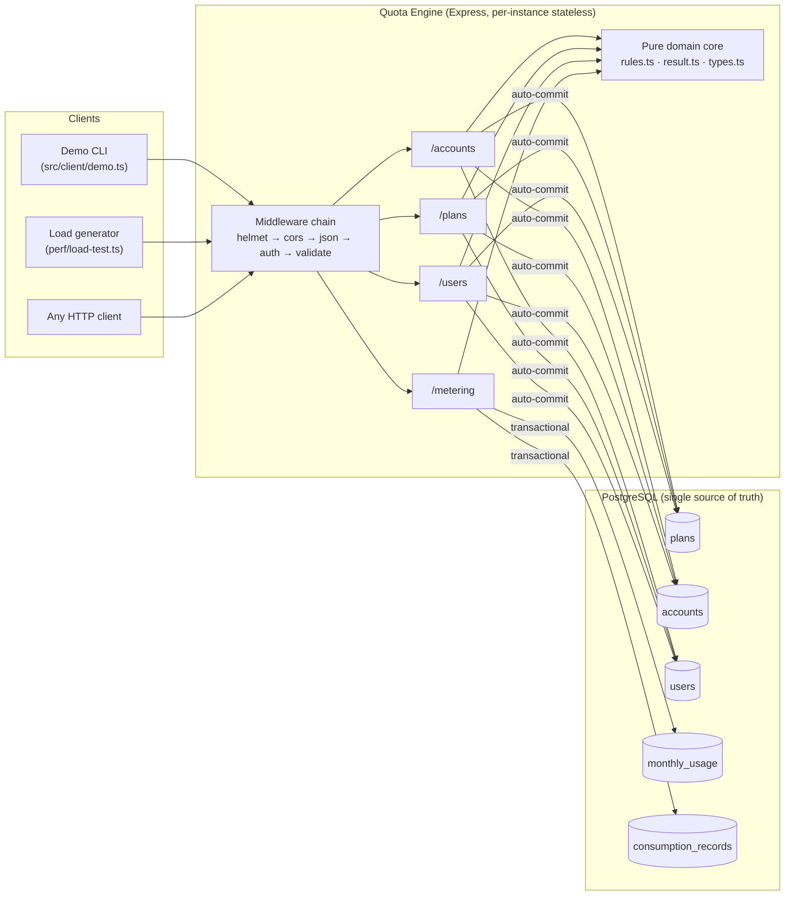
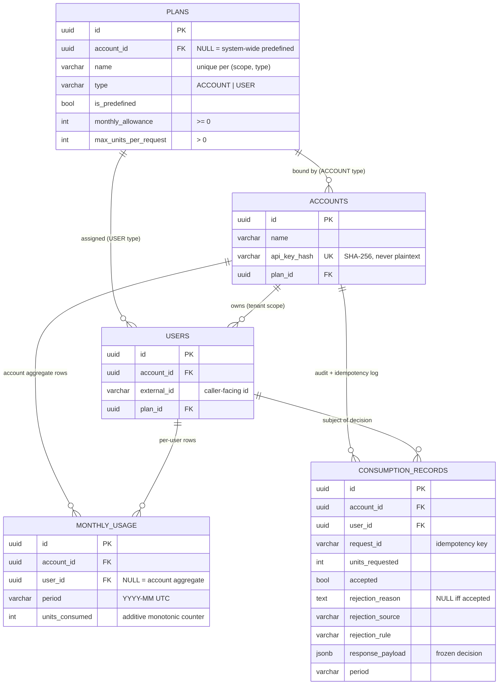
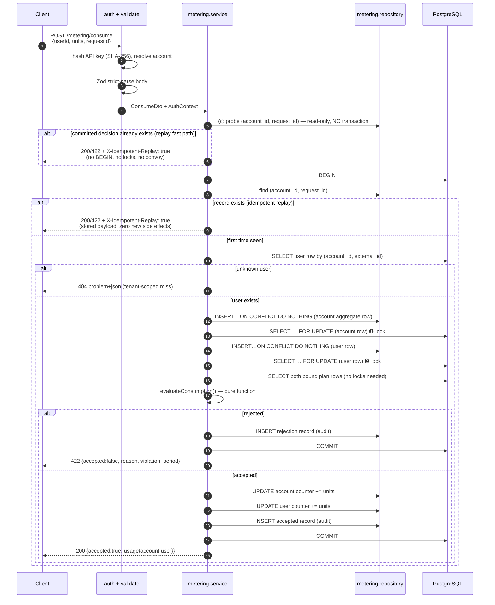
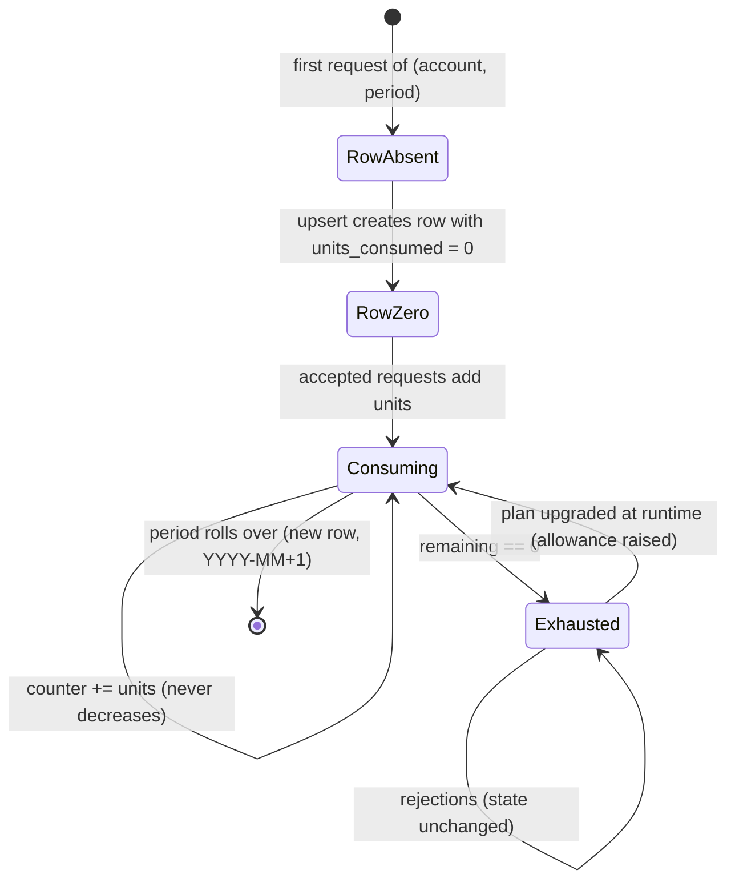
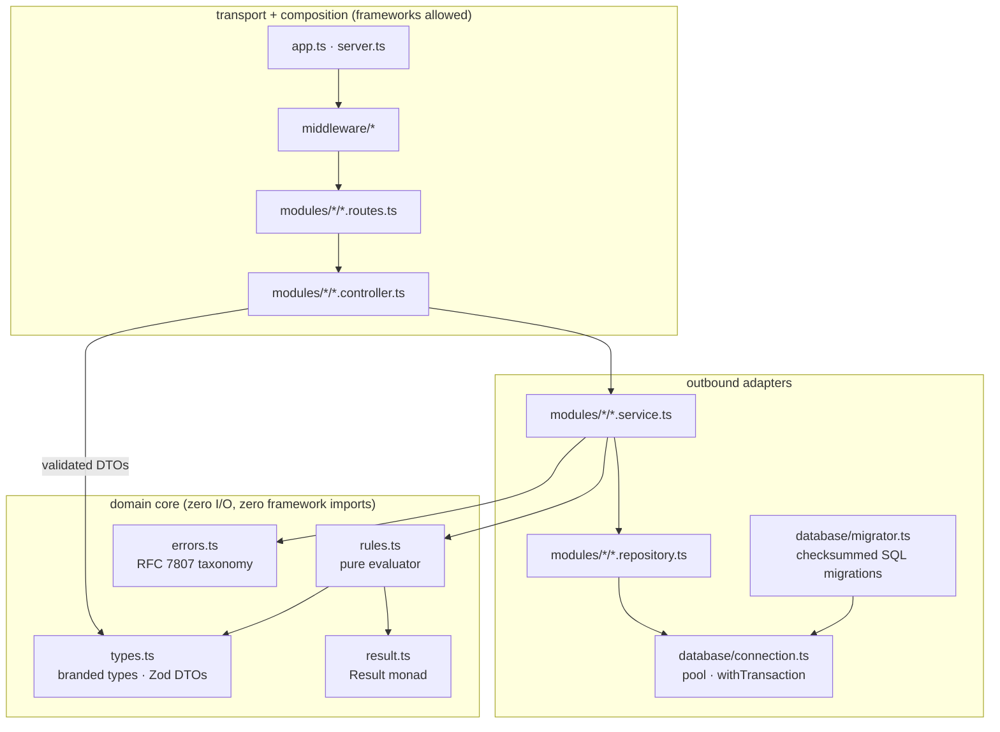

# Architecture

> Usage Metering & Quota Engine — system design, entity relationships, request
> lifecycles, and state transitions. Companion documents:
> [`CONCURRENCY_AND_LOCKING.md`](./CONCURRENCY_AND_LOCKING.md) (correctness proofs),
> [`BENCHMARK_REPORT.md`](./BENCHMARK_REPORT.md) (measured numbers),
> [`INTERVIEW_CHEATSHEET.md`](./INTERVIEW_CHEATSHEET.md) (defense Q&A).

---

## 1. System context

Key properties:

- **Stateless API tier** — every instance serves any request; horizontal
  scaling requires no coordination between instances. All coordination
  happens on PostgreSQL row locks (see §4).
- **One transactional decision point** — `/metering/consume` is the only
  endpoint that mutates quota state, and it does so inside exactly one
  database transaction per request.
- **Pure decision core** — the accept/reject decision is computed by
  `evaluateConsumption()`, a referentially transparent function with zero
  I/O, fully unit-tested outside any database.

---

## 2. Entity relationships

### 2.1 Referential-integrity guards

`CHECK` constraints cannot reference other tables, so plan-type binding is
enforced by triggers (`001_initial_schema.sql`, §6):

- `accounts_plan_type_guard` — an account may only bind an `ACCOUNT`-type plan.
- `users_plan_type_guard` — a user may only be assigned a `USER`-type plan.

Even hand-written SQL cannot violate the binding rules.

### 2.2 Design decision: accounts ⇄ plans mutual reference

`accounts.plan_id` is `NOT NULL` and `plans.account_id` (for custom plans)
points back at an account. The two FKs are *intentionally* mutually
referential; `001_initial_schema.sql` creates `plans` first, then
`accounts`, then attaches the `plans → accounts` FK. A deferred-bind
pattern that keeps the catalog (predefined plans) usable before any
account exists.

---

## 3. Request lifecycles

### 3.1 Consume — the quota decision (the critical path)

**Lock ordering** ➊ → ➋ is the load-bearing rule: account aggregate row
*always* before user row. The full proof of deadlock-freedom and
zero-overrun is in [`CONCURRENCY_AND_LOCKING.md`](./CONCURRENCY_AND_LOCKING.md).

**Why the lazy `INSERT … ON CONFLICT DO NOTHING` before each lock?**
`monthly_usage` rows are created on first touch — a fresh account/user/month
triple has no row to lock yet. The upsert is the well-known
"ensure-then-lock" pattern: exactly one concurrent writer inserts, the
others take the `DO NOTHING` path and proceed to `SELECT … FOR UPDATE`,
which blocks until the winner commits and the row becomes visible.

### 3.2 Idempotency semantics

Idempotency is a **database-level guarantee**, not an application-level
convention:

- `UNIQUE (account_id, request_id)` on `consumption_records`.
- The decision payload (`response_payload JSONB`) is stored in the same
  row that enforces the key, so "the decision" and "the idempotency
  registry" cannot diverge.
- A retry returns the frozen payload with `X-Idempotent-Replay: true` and
  the original status code (200 for accepted, 422 for rejected).
- If two requests with the same key race, the loser's INSERT raises
  SQLSTATE `23505`, aborting its entire transaction — **including its
  counter increments** — and the service then serves the winner's stored
  payload. This is why a retried request can never double-charge, even
  under parallel delivery (at-least-once networks, UI double-clicks,
  mobile retries).

An idempotency key maps to exactly one immutable decision: to get a *new*
decision after a plan upgrade, a client must supply a *new* `requestId`
(the demo client, Phase 6, does exactly this).

### 3.3 Read-only projections

`GET /metering/usage` and `GET /metering/history` never take locks — plain
MVCC snapshot reads. A heavy analytics query cannot delay billing
decisions, and vice versa.

---

## 4. State & data-flow model

### 4.1 Monotonic counters — the single quota state machine

There is deliberately **no "balance" column anywhere**. The only mutable
quota state is `monthly_usage.units_consumed`, and it is
append/increment-only within a period:

- `remaining = GREATEST(0, plan.monthly_allowance - units_consumed)` is
  **derived at read time** — never stored, never decremented.
- Mid-month plan **downgrade** below current usage: counters are untouched;
  `remaining` evaluates to `0`; all new requests are rejected until the
  next UTC month. History stays truthful (audit integrity).
- Mid-month plan **upgrade**: `remaining` instantly expands; prior usage is
  preserved (demo Phase 6).
- Period rollover is *implicit*: `currentUtcPeriod()` computes `YYYY-MM`
  from UTC now; requests for a new month lazily create fresh zero rows.
  No cron, no scheduler, no reset job to race against.

### 4.2 Plan binding states

```mermaid
stateDiagram-v2
    state "predefined catalog (account_id NULL)" as Cat {
        [*] --> StarterPro: seed
    }
    StarterPro --> AccountBound: create account (planName)
    AccountBound --> AccountBound: PATCH /accounts/plan<br/>(predefined or own custom)
    AccountBound --> CustomPlanOwned: POST /plans
    CustomPlanOwned --> CustomPlanOwned: PATCH /plans/:id<br/>(limits/name; type immutable)
    CustomPlanOwned --> CustomPlanDeleted: DELETE /plans/:id<br/>(409 while bound → rebind → delete)
    StarterPro --> UserAssigned: POST /users
    UserAssigned --> UserAssigned: PATCH /users/:userId/plan<br/>(runtime rule change, usage preserved)
```

- Predefined plans are system-wide (`account_id IS NULL`, seeded by
  `npm run seed`): `Starter` (100/mo, max 10/req) and `Pro` (500/mo, max
  50/req) for accounts; `Basic` (100/mo, max 20/req) and `Premium`
  (300/mo, max 50/req) for users.
- Custom plans are tenant-scoped; an account can only bind plans that are
  predefined **or owned by itself** (IDOR-safe resolution, §5).
- Custom-plan lifecycle: **update** any owned plan (type is immutable);
  **delete** only while unbound — a 409 names the remaining bindings, and
  subjects are rebindable via `PATCH /accounts/plan` and
  `PATCH /users/:userId/plan`. Pinned by `tests/integration/plans-crud.test.ts`.
- Changing a plan never touches usage rows — that is the whole point of
  monotonic counters. Racing a plan change against live consumption is
  covered by `tests/concurrency/plan-mutation-race.test.ts`.

### 4.3 Consumption record shape (audit + idempotency, one row)

The `rejection_shape` CHECK constraint makes malformed rows impossible:

| `accepted` | `rejection_reason` | `rejection_source` | `rejection_rule` |
|:---:|:---:|:---:|:---:|
| `true`  | must be NULL | must be NULL | must be NULL |
| `false` | must be set | must be set | must be set |

`response_payload` always holds the exact JSON the caller received — the
audit trail and the idempotency cache are the *same* row, so they can
never disagree.

### 4.4 Append-only ledger + derived snapshot (the accounting architecture)

The quota state is deliberately split into the same two-piece structure a
professional accounting system uses:

| Piece | Table | Role |
|---|---|---|
| **Immutable ledger** | `consumption_records` | Append-only. One row per REQUEST — accepted AND rejected — with the frozen response payload and rejection forensics. Never updated after commit; richer than a units-only event log because rejections are first-class history too. Its `UNIQUE (account_id, request_id)` doubles as the idempotency registry, so the ledger and the replay cache cannot diverge. |
| **O(1) balance anchor** | `monthly_usage` | The materialized snapshot the engine reads and locks. Maintained *atomically in the same transaction* as the ledger insert — both commit or neither does, so the snapshot can never drift from the ledger. |

**Point-in-time reconstruction** is therefore always available and
verifiable: `Σ units_requested` over accepted records for a given
`(user, period)` equals the snapshot counter exactly (this identity is
asserted by the concurrency suites and the property-based stress). Reads
at O(1); full history at O(log n) via the audit indexes.

**Why no `version` column (optimistic concurrency) on the snapshot?** A
guide-style balances table pairs the ledger with a version counter for OCC
retries. This engine deliberately uses pessimistic `FOR UPDATE` row locks
instead: under a hot account, OCC degenerates into retry storms at exactly
the point of maximal contention, while the row-lock queue is scheduled,
bounded, and makes over-consumption impossible by construction (see
[`CONCURRENCY_AND_LOCKING.md`](./CONCURRENCY_AND_LOCKING.md) §5 for the
full trade-off analysis).

---

## 5. Multi-tenant isolation model (IDOR hardening)

Every request authenticates an **account** (API key → SHA-256 →
`accounts.api_key_hash` unique index). Every subsequent operation is
scoped by that `account_id`:

| Caller-supplied input | How it is resolved | Cross-tenant result |
|---|---|---|
| `userId` (external id) | `WHERE account_id = $auth AND external_id = $userId` | 404 — cannot distinguish "other tenant's user" from "nonexistent" |
| plan by `planId` | predefined **or** `account_id = $auth` | 404 for foreign custom plans |
| plan by `planName` | own custom plan shadows predefined | 404 if none visible |
| `requestId` | uniqueness scoped to `(account_id, request_id)` | two tenants may safely use the same UUID key |

Internal UUIDs (`users.id`, `accounts.id`) are never accepted from
clients; the caller-facing identifier is `users.external_id`. This
composite (`account_id`, `external_id`) is UNIQUE and indexed —
`unique_user_per_account` doubles as the lookup path.

API-key lifecycle: generated as 256-bit `mk_<base64url>` secrets, stored
**only** as SHA-256 hex digests, returned exactly once (creation or
rotation). Rotation is a single atomic `UPDATE` — no revocation list, no
eventual consistency window. (See the cheatsheet §Q10 for why SHA-256 —
not a password hash — is the correct choice for high-entropy API keys.)

---

## 6. Module layout (clean architecture)

Dependency rule: **arrows point inward**. `src/domain/` imports nothing
from `src/modules`, `src/database`, or Express; it is 100% unit-testable
without a database or HTTP server. Repositories accept an `SqlExecutor`
(pool or transactional client) so the *service* owns transaction
boundaries; a repository can never commit or roll back on its own.

Error handling follows the same discipline: the domain throws typed
`DomainError`s carrying their own HTTP status; exactly one renderer
(`problemDetailsHandler`) converts them to RFC 7807 `application/problem+json`
responses. Controllers never invent status codes.

---

## 7. Indexing decisions (and one deliberate omission)

| Index | Serves | Notes |
|---|---|---|
| `plans` UNIQUE `(account_id, name, type)` NULLS NOT DISTINCT | plan-name scoping | provided by the constraint's backing index |
| `accounts` UNIQUE `(api_key_hash)` | auth lookup | O(log n) per request, constant-size key |
| `users` UNIQUE `(account_id, external_id)` | tenant-scoped user resolution inside the consume transaction | doubles as the IDOR-safety net |
| `monthly_usage` UNIQUE `(account_id, user_id, period)` NULLS NOT DISTINCT | the `FOR UPDATE` lock targets | the hot path of the entire engine |
| `monthly_usage` `(account_id, period)` | account-wide usage aggregation for a month | the constraint index is ordered `(account_id, user_id, period)` and cannot serve account+period-only scans efficiently |
| `consumption_records` UNIQUE `(account_id, request_id)` | idempotency probe | constant-time replay path |
| `consumption_records` `(account_id, period, created_at DESC)` | audit history by month | spec-mandated |
| `consumption_records` `(account_id, user_id, created_at DESC)` | per-user history drilldown | composite prefix covers tenant scoping |

**Deliberate omission:** the reference DDL also listed
`idx_usage_lookup (account_id, user_id, period)` and
`idx_user_external_account (account_id, external_id)` — exact duplicates of
the UNIQUE-constraint backing indexes above. PostgreSQL already implements
every UNIQUE constraint with a btree index; duplicating them would double
write amplification on our two hottest tables with zero read benefit.
`002_indexes.sql` documents this and keeps only the non-covered indexes.

---

## 8. Operational lifecycle

- **Migrations** (`src/database/migrator.ts`): plain `.sql` files, each
  applied in its own transaction, guarded by a session advisory lock
  (`pg_advisory_lock`) so concurrent boots cannot race; applied files are
  checksummed (SHA-256) in `schema_migrations` — editing an applied
  migration is a hard error.
- **Graceful shutdown** (`src/server.ts`): SIGINT/SIGTERM → stop accepting
  connections → drain in-flight requests (they hold pooled DB clients) →
  `pool.end()` → exit; a 10s hard deadline guarantees the process never
  hangs.
- **Crash safety**: if the process dies mid-transaction, PostgreSQL rolls
  the transaction back automatically — counters and audit records commit
  together or not at all, so a crash can never produce a charged request
  without its audit row (or vice versa).
- **Health**: `GET /health` verifies both process liveness and a real
  `SELECT 1` against the database.
